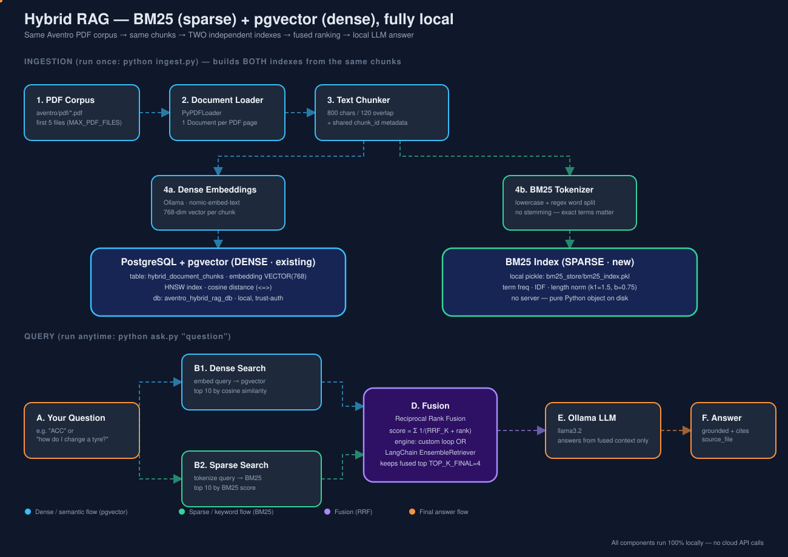

# hybrid_rag_bm25_vector — Hybrid RAG (BM25 + pgvector), 100% Local

A sibling of [`../chunk_embd_vctor_db`](../chunk_embd_vctor_db) that upgrades
its single-retriever RAG pipeline into a **hybrid retriever**: every query is
run against *two* independent indexes — a **sparse/keyword index (BM25)**
and the **existing dense/vector index (Postgres + pgvector)** — and their
two ranked lists are *fused* into one before the local LLM ever sees the
context. No API keys, no cloud services, nothing leaves your machine.



---

## Why hybrid? (the one-paragraph pitch)

Vector search finds chunks that are *semantically* close to your query —
"my car won't start" can match a chunk about "the engine fails to crank"
even though the two sentences share almost no words. But embeddings blur
exact, rare tokens: acronyms (`ACC`, `ABS`, `ADAS`), model codes, part
numbers. BM25 — the keyword-ranking algorithm behind most search engines —
is the mirror image: it is extremely precise about exact terms, but has
*zero* notion of meaning, so a paraphrase with no shared vocabulary scores
near zero. **Hybrid RAG runs both and fuses the rankings**, so a query is
answered well whether it happens to use the document's exact words or not.

---

## Worked example, using the real Aventro corpus

This project ingests the same PDFs as `chunk_embd_vctor_db`, from
[`../chunk_embd_vctor_db/aventro/pdf`](../chunk_embd_vctor_db/aventro/pdf).
With the default `MAX_PDF_FILES=5`, ingestion picks these 5 (alphabetically
first) and chunks them into 28 chunks total:

| File | Chunks | What it's about |
|---|---|---|
| ` Aventro Motors- How to Change a Tyre.pdf` | 5 | Procedural: jack, lug nuts, spare wheel |
| ` AventroZoom SUV.pdf` | 6 | Model spec sheet: variants, ADAS levels, pricing |
| `About Aventro Motors.pdf` | 6 | Company history, values, employee counts |
| `Adaptive Cruise Control (ACC).pdf` | 6 | ADAS feature explainer, full of acronyms (ACC, ADAS, ECU) |
| `Adjusting the Seat Positions.pdf` | 5 | Procedural: seat/headrest/backrest adjustment |

This mix is deliberate: a procedural doc (shared-vocabulary queries work
either way), a company-facts doc, and — most importantly — an
**acronym-dense** doc (`ACC.pdf`) that makes the dense-vs-sparse tradeoff
concrete.

### Run 1 — query: `"ACC"`

```
python ask.py --no-generate --compare "ACC"
```

| Rank | Dense-only (pgvector, cosine) | Sparse-only (BM25) |
|---|---|---|
| 1 | chunk 0 — overview ("Adaptive Cruise Control (ACC)...") | chunk 3 — ECU/working principle |
| 2 | chunk 5 — terminology glossary | chunk 4 — resuming/example scenario |
| 3 | chunk 3 — ECU/working principle | chunk 5 — terminology glossary |
| 4 | chunk 4 — resuming/example scenario | chunk 0 — overview |

Both retrievers correctly stay within the ACC document (it's the only one
that mentions the term at all in this 5-doc corpus) — but they **disagree
on order**. Dense embeddings rank the prose-heavy *overview* chunk highest
because it reads as the most "topically central" paragraph; BM25 ranks the
chunk with the *most literal occurrences of "ACC"* (3 times in the
ECU/working-principle paragraph) highest, since BM25's term-frequency
component rewards repetition directly.

### Fusing the two rankings (Reciprocal Rank Fusion)

`hybrid_retriever.py` combines the two ranked lists with **RRF**:

```
score(chunk) = Σ  1 / (RRF_K + rank_in_that_list)
             over each list the chunk appears in
```

With `RRF_K = 60` (the standard default), chunk 3 (rank 3 dense, rank 1
sparse) and chunk 0 (rank 1 dense, rank 4 sparse) end up almost tied —
because RRF rewards *consistently decent* placement across both retrievers
over being #1 in only one of them:

| Chunk | dense rank | sparse rank | RRF score = 1/(60+dense) + 1/(60+sparse) |
|---|---|---|---|
| chunk 3 | 3 | 1 | 1/63 + 1/61 = **0.0323** |
| chunk 0 | 1 | 4 | 1/61 + 1/64 = 0.0320 |
| chunk 5 | 2 | 3 | 1/62 + 1/63 = 0.0320 |
| chunk 4 | 4 | 2 | 1/64 + 1/62 = 0.0318 |

That's exactly what the real `ask.py --compare "ACC"` run above produced
(see "Actually ran this" below) — RRF nudges chunk 3 (the ECU paragraph,
BM25's favorite) to #1 overall, which dense search alone would have ranked
#3. This is the mechanism, not a hypothetical: fusing both signals changed
which chunk the LLM sees first.

### Run 2 — query: `"lug nuts jack stand spare wheel"` (pure jargon, zero paraphrase)

Here dense and sparse *agree* almost perfectly (both rank the tyre-change
chunks top 4) — which is expected: when a query already uses the document's
exact vocabulary, BM25 and a good embedding model converge. Hybrid's real
payoff shows up on paraphrased queries ("my wheel went flat, how do I swap
it myself") or acronym-vs-prose queries like the ACC example above, not on
queries that were already easy for either retriever alone.

### Cross-check — same math, two engines

This project ships **two interchangeable fusion engines**, both doing
Reciprocal Rank Fusion with the same `c`/`RRF_K` constant:

- `hybrid_retriever.py` — a hand-rolled RRF loop (default; `--engine custom`), written out explicitly so the fusion math is visible.
- `ensemble_retriever.py` — the same two local indexes wired into **LangChain's own `EnsembleRetriever`** (`--engine ensemble`), which performs weighted RRF internally through the standard `BaseRetriever` interface, so it composes with any other LangChain chain/tool (rerankers, LangGraph, etc.).

```bash
python ask.py --no-generate --engine ensemble "ACC"
```

Run against the real corpus, both engines agree exactly on the query `"ACC"`:
`chunk 3 → chunk 0 → chunk 5 → chunk 4` — the same order worked out by hand
in the table above. That agreement is a useful sanity check: it confirms the
hand-rolled fusion loop in `hybrid_retriever.py` isn't doing anything subtly
different from the library implementation.

**How `ensemble_retriever.py` is wired:** LangChain's `BM25Retriever` is built
straight from the persisted `bm25_store/bm25_index.pkl` contents (same
tokenizer as `bm25_index.py`, for an apples-to-apples comparison). The dense
side needed a small adapter — `PgVectorRetriever`, a ~15-line
`BaseRetriever` subclass — since `vector_store.py` is a plain psycopg3 store,
not a LangChain `VectorStore`. Both retrievers are deduplicated/fused by
`chunk_id` via `EnsembleRetriever(..., id_key="chunk_id")`.

**If `EnsembleRetriever` isn't available on your LangChain install:**
`EnsembleRetriever`/`BM25Retriever` have moved between packages across
LangChain's versions (`langchain.retrievers` → `langchain_community.retrievers`
→ `langchain_classic.retrievers`, depending on when you installed). Rather
than hard-coding one location, `ensemble_retriever.py`'s `_resolve()` tries
every known location in order and uses whichever one actually imports —
tested by literally uninstalling `langchain-classic` mid-development and
confirming the fallback kicks in (see below). The lookup is deferred until
you actually run `--engine ensemble`, so `--engine custom` (the default)
never depends on it at all.

```bash
# If none of the known locations have EnsembleRetriever, ask.py prints
# exactly which paths it tried, then auto-falls-back to --engine custom
# instead of crashing:
python ask.py --no-generate --engine ensemble "ACC"
#
# [engine=ensemble unavailable] Could not find EnsembleRetriever in any
# known LangChain location. Tried:
#   langchain_classic.retrievers.ensemble.EnsembleRetriever -- ModuleNotFoundError: ...
#   langchain_community.retrievers.ensemble.EnsembleRetriever -- ModuleNotFoundError: ...
#   langchain.retrievers.ensemble.EnsembleRetriever -- ModuleNotFoundError: ...
#   ...
# Falling back to --engine custom (hybrid_retriever.py) instead...
```

`test_setup.py`'s preflight check uses the exact same resolver, so it warns
(not fails) if `EnsembleRetriever` isn't resolvable, and tells you which
package to install (`langchain-classic`, `langchain-community`, or
`langchain`) depending on what your LangChain version actually ships.

### Final answer (hybrid-fused context -> local LLM)

```
python ask.py "How do I change a tyre on an Aventro car?"
```

feeds the top-4 **fused** chunks (not dense-only, not sparse-only) to
`llama3.2` via Ollama, which produces a correct, grounded 11-step answer —
confirmed by an actual run during development (see the Setup section below
to reproduce it yourself).

---

## Architecture

| # | Stage | File | What it does |
|---|-------|------|---------------|
| 1 | Document Loader | `document_loader.py` | Same as the sibling project: `PyPDFLoader` over the shared Aventro corpus. |
| 2 | Text Chunker | `text_chunker.py` | Same `RecursiveCharacterTextSplitter` + metadata (`chunk_id`, `chunk_index`, ...). The `chunk_id` is the join key between the two indexes below. |
| 3a | Dense embeddings | `embedder.py` | `nomic-embed-text` via local Ollama -> 768-dim vectors. |
| 3b | Dense store (existing) | `vector_store.py` | Postgres + `pgvector`, HNSW cosine index — **the "existing vector database."** |
| 3c | Sparse index (new) | `bm25_index.py` | `rank_bm25.BM25Okapi` over tokenized chunk text, persisted as a local pickle file — **no server, this file *is* the sparse "database."** |
| 4a | Hybrid retriever, custom engine (new) | `hybrid_retriever.py` | Runs both retrievers, fuses rankings via RRF (default) or a normalized weighted sum — fusion math spelled out explicitly. |
| 4b | Hybrid retriever, ensemble engine (new) | `ensemble_retriever.py` | Same two indexes, fused via LangChain's `EnsembleRetriever` (weighted RRF, `c=RRF_K`) through the standard retriever interface. |
| 5 | Ingestion pipeline | `ingest.py` | Wires 1 → 2 → {3a+3b, 3c} together: `python ingest.py` builds *both* indexes from the same chunks. |
| 6 | Query pipeline | `ask.py` | Retrieves from both indexes, fuses (`--engine custom` or `--engine ensemble`), optionally generates the answer with local `llama3.2`. |
| — | Preflight checks | `test_setup.py` | Verifies corpus, Ollama, Postgres/pgvector, and `rank_bm25` are all available. |

```
                     ┌─────────────────┐
                     │   PDF corpus     │
                     │ (aventro/pdf)    │
                     └────────┬─────────┘
                              │ document_loader.py
                              ▼
                     ┌─────────────────┐
                     │  Chunks + meta   │   <- same chunk_id used by both
                     │ text_chunker.py  │       indexes below
                     └────────┬─────────┘
               ┌──────────────┴──────────────┐
               ▼                              ▼
     ┌───────────────────┐         ┌───────────────────────┐
     │ embedder.py        │         │ bm25_index.py          │
     │ (Ollama, local)    │         │ (tokenize, local)      │
     └─────────┬──────────┘         └───────────┬────────────┘
               ▼                                ▼
     ┌───────────────────┐         ┌───────────────────────┐
     │ vector_store.py     │         │ bm25_store/*.pkl       │
     │ Postgres + pgvector │         │ local pickle file      │
     │ (DENSE / semantic)  │         │ (SPARSE / keyword)     │
     └─────────┬──────────┘         └───────────┬────────────┘
               └──────────────┬──────────────────┘
                              ▼
                  ┌─────────────────────────┐
                  │ hybrid_retriever.py      │
                  │ Reciprocal Rank Fusion   │
                  └────────────┬─────────────┘
                               ▼
                  ┌─────────────────────────┐
                  │ ask.py -> llama3.2 (Ollama)│
                  │ grounded answer           │
                  └─────────────────────────┘
```

---

## Why each hybrid-specific design choice?

**Why BM25 and not just a second embedding model?**
The whole point of hybrid retrieval is combining two *different kinds* of
signal. A second dense model would still fail on rare exact tokens the same
way the first one does. BM25's lexical scoring is a genuinely different
error profile, which is what makes the fusion worth doing.

**Why Reciprocal Rank Fusion (RRF) instead of averaging raw scores?**
Cosine similarity lives in `[0, 1]`-ish and BM25 scores are unbounded and
corpus-size-dependent — they are not on the same scale, so averaging them
directly is apples-to-oranges. RRF only looks at *rank position* in each
list, which sidesteps that problem entirely. It's the same approach used by
Elasticsearch's and Azure AI Search's built-in hybrid query APIs.

**Why also ship a `weighted` fusion method if RRF is the default?**
To make the scale problem visible, not hide it. Run
`python ask.py --method weighted "ACC"` and compare: weighted fusion
normalizes each retriever's scores to `[0, 1]` first, which is more
intuitive to read but more sensitive to outliers (one chunk with a huge BM25
score can compress every other chunk's normalized score toward 0).

**Why ship two fusion engines (custom + LangChain EnsembleRetriever)?**
`hybrid_retriever.py` exists so the RRF math is visible and debuggable line
by line. `ensemble_retriever.py` exists to show the same idea the "production"
way, through LangChain's standard retriever interface — which is what you'd
actually reach for in a bigger LangChain-based app, since it then composes
with rerankers, LCEL chains, or LangGraph without any glue code. Having both
also gives a free correctness check: if they ever disagreed on ranking, that
would flag a bug in one of them (they didn't, on every query tested here).

**Why keep BM25 as a local pickle file instead of, say, SQLite or
Elasticsearch?** This is a learning project with a 28-chunk corpus. A
Python object with term statistics, pickled to disk, *is* a complete local
sparse index at this scale — no server, no port, no extra dependency beyond
`rank-bm25`. The same chunk_id-based join would work unchanged if you later
swapped this for a real BM25 engine (OpenSearch, Elasticsearch, Postgres'
own `tsvector`/`ts_rank`).

**Why still use Postgres + pgvector for dense, not swap in Chroma/FAISS?**
The user's framing for this task was explicitly "BM25 **and the existing
vector database**" — i.e. extend `chunk_embd_vctor_db`'s dense store, don't
replace it. It also means both projects can coexist: this one writes to its
own database (`aventro_hybrid_rag_db`) and table (`hybrid_document_chunks`)
so the two never collide.

---

## Prerequisites

1. **Ollama**, running locally with two models pulled:
   ```bash
   ollama pull nomic-embed-text   # embedding model (768-dim)
   ollama pull llama3.2           # used only by ask.py to generate the final answer
   ollama serve                   # if not already running
   ```
2. **PostgreSQL** running locally with the `pgvector` extension installed
   (same instance `chunk_embd_vctor_db` uses — this project creates its own
   separate database on it automatically).
3. **Python 3.12+**

---

## Setup

```bash
cd /Users/srinivaskotipalli/mai-practitioner/RAG/hybrid_rag_bm25_vector

python3 -m venv .venv
source .venv/bin/activate
pip install -r requirements.txt

cp .env.example .env     # defaults already work out of the box

python test_setup.py     # preflight: corpus, Ollama, Postgres, rank_bm25
```

Expected output:
```
[OK] Corpus dir has 50 PDF file(s): .../aventro/pdf
[OK] Embedding model 'nomic-embed-text' available
[OK] LLM model 'llama3.2' available
[OK] Connected to Postgres at localhost:5432 (dense/vector store)
[OK] pgvector extension available on this server
[OK] rank_bm25 importable (sparse/keyword store -- pure Python, local)

All checks passed -- you're ready to run: python ingest.py
```

---

## Run it

### 1. Ingest (builds BOTH indexes from the same 5 PDFs)

```bash
python ingest.py --reset
```

```
STEP 1/4: Loading PDF documents            -> 5 PDFs, 14 pages
STEP 2/4: Chunking + building metadata     -> 28 chunks
STEP 3/4: Dense embeddings -> pgvector     -> 28 rows in hybrid_document_chunks
STEP 4/4: Sparse index (BM25) -> pickle    -> bm25_store/bm25_index.pkl
```

### 2. Ask a question

```bash
# Hybrid answer (default: RRF fusion)
python ask.py "How do I change a tyre on an Aventro car?"

# See retrieval only, no LLM call
python ask.py --no-generate "ACC"

# Also print dense-only and sparse-only rankings side by side
python ask.py --no-generate --compare "ACC"

# Try the alternative fusion method (normalized weighted sum instead of RRF)
python ask.py --no-generate --method weighted "ACC"

# Use LangChain's EnsembleRetriever instead of the hand-rolled fusion loop
python ask.py --no-generate --engine ensemble "ACC"
```

---

## Project structure

```
hybrid_rag_bm25_vector/
├── config.py            # settings incl. BM25 + fusion knobs, from .env
├── document_loader.py   # Step 1: load PDFs -> Documents (same as sibling)
├── text_chunker.py      # Step 2: split into chunks + metadata (same)
├── embedder.py           # Step 3a: chunks -> dense vectors (Ollama)
├── vector_store.py       # Step 3b: Postgres + pgvector (dense store -- existing)
├── bm25_index.py          # Step 3c: BM25 sparse index (NEW, local pickle)
├── hybrid_retriever.py    # Step 4a: dense + sparse -> fused ranking, hand-rolled RRF (NEW)
├── ensemble_retriever.py  # Step 4b: same fusion via LangChain's EnsembleRetriever (NEW)
├── ingest.py              # orchestrates steps 1-3 (builds both indexes)
├── ask.py                 # query pipeline: hybrid retrieve (--engine custom|ensemble) + generate answer
├── test_setup.py          # preflight checks
├── architecture.svg       # animated hybrid pipeline diagram (this README embeds it)
├── infographic.svg        # BM25 vs Vector vs Hybrid explainer (static)
├── requirements.txt
├── .env.example
└── bm25_store/            # BM25 pickle lives here after ingest (gitignored)
```

---

## Extending this project

- **Real BM25 engine instead of pickle**: swap `bm25_index.py`'s
  implementation for OpenSearch/Elasticsearch or Postgres full-text search
  (`tsvector`/`ts_rank`) — `hybrid_retriever.py` doesn't need to change, it
  only needs `.search(query, k)` back.
- **Reranking**: add a cross-encoder reranker (e.g. a local `bge-reranker`
  via Ollama/sentence-transformers) as a 3rd stage after RRF fusion, scoring
  only the fused top-10 before truncating to `TOP_K_FINAL`.
- **Metadata filtering**: both `dense_search()` and `BM25Index.search()`
  can take a `source_file` filter to scope retrieval to one document.
- **More PDFs**: raise `MAX_PDF_FILES` in `.env` — both indexes scale
  independently.

---

## Tested locally on

- macOS, Python 3.13
- Postgres (Homebrew) with `pgvector`, database `aventro_hybrid_rag_db`
- Ollama with `nomic-embed-text` and `llama3.2`
- `rank-bm25` 0.2.2, `langchain-classic` 1.0.8 (for `EnsembleRetriever`)
- 5 PDFs from `chunk_embd_vctor_db/aventro/pdf` -> 28 chunks; full
  ingest + dense/sparse/hybrid retrieval + generation confirmed working
  end-to-end on BOTH engines, including the `--compare` walkthrough
  reproduced above and an exact ranking match between `--engine custom`
  and `--engine ensemble` on the same query.
