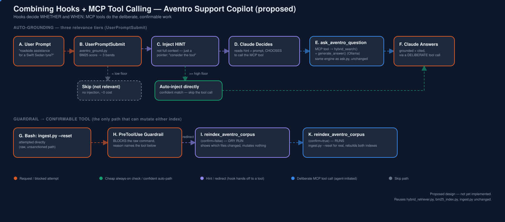

# Architecture: Combining Hooks + MCP Tool Calling

**Status:** proposed design (not yet implemented). Builds on
`../hooks_integration/ARCHITECTURE.md` (hook mechanics primer + Hooks 1-3)
and `../mcp_integration/ARCHITECTURE.md` (MCP server + tools 1-3) — read
those first; this document only specifies what's *new* where the two meet:
a three-tier relevance hook, one new MCP tool
(`reindex_aventro_corpus`), and an updated guardrail hook that redirects to
it instead of only blocking.



---

## 1. Component responsibility map

| Component | Kind | File (proposed) | Job |
|---|---|---|---|
| Auto-grounding hook | Hook, `UserPromptSubmit` | `.claude/hooks/aventro_ground.py` (extended) | Fires on every prompt; decides between **skip / nudge / auto-inject** (§2) |
| Guardrail hook | Hook, `PreToolUse` on `Bash` | `.claude/hooks/aventro_guardrail.py` (extended) | Blocks raw destructive commands; redirects to the reindex tool (§3) |
| Reindex-nudge hook | Hook, `PostToolUse` on `Write\|Edit` | `.claude/hooks/aventro_reindex_check.py` (extended) | Notices corpus drift; nudges toward the reindex tool instead of a copy-pasteable CLI command (§4) |
| `search_aventro_docs` | MCP tool | `mcp_server.py` (unchanged from `../mcp_integration/`) | Retrieval only, agent-initiated |
| `ask_aventro_question` | MCP tool | `mcp_server.py` (unchanged) | Full RAG answer, agent-initiated |
| `list_ingested_sources` | MCP tool | `mcp_server.py` (unchanged) | Corpus introspection |
| **`reindex_aventro_corpus`** | MCP tool, **new** | `mcp_server.py` (new tool) | The one sanctioned, confirmable way to rebuild both indexes (§3) |

Everything in the left column that says "hook" runs deterministically, on
the harness side, for every matching event. Everything that says "MCP
tool" only runs when an agent (Claude) decides to call it. That split is
the entire design.

---

## 2. Three-tier auto-grounding hook

Extends `../hooks_integration/ARCHITECTURE.md §2`'s single-threshold
design into three bands:

```python
#!/usr/bin/env python3
"""UserPromptSubmit hook, extended: skip / nudge-toward-tool / auto-inject."""

import json, sys
sys.path.insert(0, "/Users/srinivaskotipalli/mai-practitioner/RAG/hybrid_rag_bm25_vector")
from bm25_index import BM25Index
from hybrid_retriever import hybrid_search

RELEVANCE_FLOOR_LOW = 0.5    # below this: not relevant, do nothing
RELEVANCE_FLOOR_HIGH = 2.0   # at/above this: confidently relevant, auto-inject

def main():
    event = json.load(sys.stdin)
    prompt = event.get("prompt", "")

    bm25 = BM25Index.load()
    hits = bm25.search(prompt, k=3)
    top_score = hits[0]["sparse_score"] if hits else 0.0

    if top_score < RELEVANCE_FLOOR_LOW:
        return  # not relevant -- exit 0, silent, ~0 cost

    if top_score < RELEVANCE_FLOOR_HIGH:
        # AMBIGUOUS: don't guess for the model -- point it at the tool instead
        context = (
            "This prompt may relate to Aventro Motors documentation "
            "(low-confidence keyword match). Consider calling the "
            "`search_aventro_docs` or `ask_aventro_question` MCP tool "
            "(server: aventro-rag) before answering from general knowledge."
        )
    else:
        # CONFIDENT: skip the round trip, inject full hybrid context directly
        fused = hybrid_search(prompt, bm25, k_final=4)
        context = "\n\n".join(
            f"[{r['source_file']} chunk {r['chunk_index']}]\n{r['content']}" for r in fused
        )

    print(json.dumps({
        "hookSpecificOutput": {
            "hookEventName": "UserPromptSubmit",
            "additionalContext": context,
        }
    }))

if __name__ == "__main__":
    main()
```

**Why not just always auto-inject (the simpler `../hooks_integration/`
design)?** Because a mediocre BM25 score is exactly the case where
auto-injecting 4 possibly-irrelevant chunks can crowd the model's context
with noise instead of signal. Routing that case to a deliberate tool call
lets the *agent* decide how hard to look (e.g., call
`ask_aventro_question` with the `ensemble` engine, or search a specific
`source_file`) rather than the hook guessing once and committing.

**Why not just always route to the tool, even for confident matches?**
Because that would add a full round trip (and the model's own latency to
decide to call it) to every clearly-relevant prompt, for no benefit — the
hook already has the answer at that confidence level. Reserve the tool
hand-off for exactly the band where a human would also hesitate.

---

## 3. New MCP tool — `reindex_aventro_corpus`

Added to `mcp_server.py` (see `../mcp_integration/ARCHITECTURE.md §4` for
how the other tools are defined; this follows the same shape):

```jsonc
{
  "name": "reindex_aventro_corpus",
  "description": "Rebuilds the BM25 pickle and the pgvector table from the current aventro/pdf + aventro/md corpus. With confirm=false (default), returns a dry-run summary only -- nothing is changed. With confirm=true, actually runs ingest.py --reset.",
  "inputSchema": {
    "type": "object",
    "properties": {
      "confirm": { "type": "boolean", "default": false }
    },
    "required": ["confirm"]
  }
}
```

Server-side sketch:

```python
def reindex_aventro_corpus(confirm: bool = False) -> dict:
    current_files = sorted(Path(config.CORPUS_DIR).glob("*.pdf"))[:config.MAX_PDF_FILES]
    indexed_files = {row[0] for row in vector_store.distinct_source_files()}  # new tiny query

    changed = [f.name for f in current_files if f.name not in indexed_files]

    if not confirm:
        return {
            "would_run": "python ingest.py --reset",
            "new_or_changed_files": changed,
            "note": "Call again with confirm=true to actually rebuild both indexes.",
        }

    import ingest
    ingest.run(reset=True)
    return {"status": "reindexed", "files_processed": len(current_files)}
```

This is the **only** code path in this entire design that mutates either
index — everything else (hooks, `search_aventro_docs`,
`ask_aventro_question`) is read-only. Keeping the blast radius to one
function, gated by an explicit boolean an agent has to pass twice (call
once to see the dry run, again to confirm), is the whole safety story.

---

## 4. Guardrail hook, extended to redirect

`../hooks_integration/ARCHITECTURE.md §5`'s guardrail only blocked. The
`reason` string now names the sanctioned replacement:

```python
DANGEROUS = [
    r"ingest\.py\s+--reset",
    r"TRUNCATE\s+.*hybrid_document_chunks",
    r"DROP\s+DATABASE\s+.*aventro_hybrid_rag_db",
    r"rm\s+-rf\s+.*bm25_store",
]

for pattern in DANGEROUS:
    if re.search(pattern, command, re.IGNORECASE):
        print(json.dumps({
            "decision": "block",
            "reason": (
                f"{command!r} would destroy the hybrid RAG indexes directly. "
                "Use the `reindex_aventro_corpus` MCP tool instead (call with "
                "confirm=false first to preview, then confirm=true) -- it goes "
                "through the same code path but with a dry-run step first."
            ),
        }))
        sys.exit(0)
```

Nothing about *blocking* changed from the hooks-only design — only the
message now gives Claude somewhere sanctioned to go instead of a dead end.

---

## 5. Reindex-nudge hook, extended

`../hooks_integration/ARCHITECTURE.md §4`'s version printed a copy-pasteable
shell command to stderr. The combined version instead nudges toward the
tool (still non-blocking, still just output the harness/model can act on
or ignore):

```python
print(
    f"[hooks] {Path(path).name} changed under the Aventro corpus. "
    f"Consider calling reindex_aventro_corpus(confirm=true) (aventro-rag MCP "
    f"server) once your edits are done, to bring both indexes back in sync.",
    file=sys.stderr,
)
```

Still intentionally **not** auto-triggering a reindex itself — even with a
confirmable tool available, letting the *agent* decide the right moment
(e.g., after a batch of edits, not after every keystroke) is unchanged from
the hooks-only design's reasoning (`../hooks_integration/ARCHITECTURE.md §4.2`).

---

## 6. Sequence — the ambiguous-query path, end to end

```
User: "Can you check if the Aventro Swift Sedan's tyre comes with roadside assistance?"
   │
   ▼
UserPromptSubmit hook → BM25 top score = 1.2  (between 0.5 and 2.0 → AMBIGUOUS band)
   │
   ▼
Hook injects a short HINT (not chunks): "...consider calling ask_aventro_question..."
   │
   ▼
Claude reads the hint + the actual prompt, DECIDES to call the MCP tool
   │
   ▼
ask_aventro_question(question="...") → mcp_server.py
   │
   ▼
hybrid_retriever.hybrid_search() [BM25 + pgvector + RRF]  →  generate_answer() [Ollama llama3.2]
   │
   ▼
MCP tool result: {"answer": "...", "sources": [...]}
   │
   ▼
Claude relays the grounded, cited answer to the rep
```

Compare this to `../hooks_integration/`'s confident-match path, which skips
the tool entirely (hook injects full context directly), and to
`../mcp_integration/`'s design, which assumed the agent would always just
happen to know to call the tool — this document is what sits between those
two.

---

## 7. settings.json — both pieces together

```jsonc
// .claude/settings.json
{
  "hooks": {
    "UserPromptSubmit": [
      { "matcher": "", "hooks": [
        { "type": "command", "command": ".venv/bin/python .claude/hooks/aventro_ground.py" }
      ]}
    ],
    "PostToolUse": [
      { "matcher": "Write|Edit", "hooks": [
        { "type": "command", "command": ".venv/bin/python .claude/hooks/aventro_reindex_check.py" }
      ]}
    ],
    "PreToolUse": [
      { "matcher": "Bash", "hooks": [
        { "type": "command", "command": ".venv/bin/python .claude/hooks/aventro_guardrail.py" }
      ]}
    ]
  },
  "mcpServers": {
    "aventro-rag": {
      "command": "/Users/srinivaskotipalli/mai-practitioner/RAG/hybrid_rag_bm25_vector/.venv/bin/python",
      "args": ["mcp_server.py"],
      "cwd": "/Users/srinivaskotipalli/mai-practitioner/RAG/hybrid_rag_bm25_vector"
    }
  }
}
```

One config file, both mechanisms, one project.

---

## 8. What stays unchanged

- All retrieval logic: `hybrid_retriever.py`, `ensemble_retriever.py`,
  `bm25_index.py`, `vector_store.py`, `embedder.py` — zero changes.
- `ask.py` / `ingest.py` CLI workflow — still works standalone, same as
  both prior proposals insisted.
- The MCP server's three original tools — unchanged, just joined by one
  new one.
- The hooks-only design's default of *warn, don't auto-reindex* — still
  true; a confirmable tool existing doesn't mean anything calls it
  automatically.
