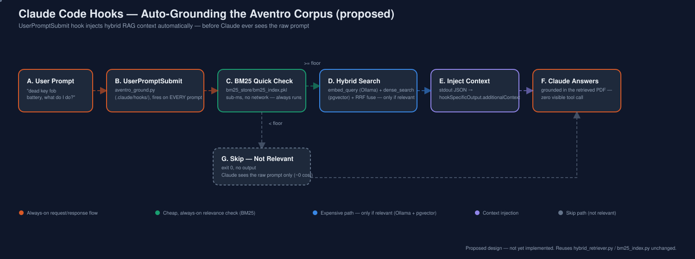

# Architecture: Claude Code Hooks for the Aventro Hybrid RAG Project

**Status:** proposed design (not yet implemented). This document first
explains how Claude Code hooks work in general, then specifies three hook
scripts that would wire this project's existing hybrid retriever into a
Claude Code session's lifecycle. See `USE_CASE.md` for *why*; this document
covers *how*. Field names for the hook JSON contract are described at the
level of "what they're for" — treat Claude Code's own `/help` hooks
reference as the source of truth for exact schema, since it can evolve
between versions.



---

## 1. How Claude Code hooks work (primer)

A **hook** is just a shell command the Claude Code harness runs for you,
automatically, when a specific lifecycle event happens during a session —
you never call it yourself, it fires on its own.

### 1.1 Where hooks are configured

Hooks live under a `"hooks"` key in a `settings.json` file. Three scopes
exist, checked in order of specificity:

| Scope | File | Typical use |
|---|---|---|
| Project (shared) | `.claude/settings.json` in the repo | Checked into git — hooks every contributor gets, like the ones proposed here. |
| Project (local) | `.claude/settings.local.json` | Gitignored — personal hooks, or project hooks you're still testing before sharing. |
| User (global) | `~/.claude/settings.json` | Hooks that apply across every project, regardless of repo. |

The `update-config` skill (available in this session) is the supported way
to add/edit hook entries in any of these files without hand-editing JSON.

### 1.2 The events

Each entry is keyed by an **event name** — the moment the hook fires:

| Event | Fires when | Can it block? |
|---|---|---|
| `UserPromptSubmit` | Right after the user submits a prompt, before the model sees it | Yes — can also **inject additional context** (used by §2.1 below) |
| `PreToolUse` | Right before a tool call executes | Yes — can approve, block, or ask for confirmation (used by §4.3) |
| `PostToolUse` | Right after a tool call completes | No (already happened) — can react to it (used by §4.2) |
| `Stop` / `SubagentStop` | When the main agent / a subagent finishes responding | No |
| `SessionStart` / `SessionEnd` | Session boundaries | No |
| `PreCompact` | Before the conversation is compacted | No |
| `Notification` | On harness notifications (permission prompts, idle, etc.) | No |

This project only needs three: `UserPromptSubmit`, `PostToolUse`, and
`PreToolUse`.

### 1.3 The contract: stdin in, exit code + stdout out

Every hook command receives a **JSON payload on stdin** describing the
event — always including at least `session_id`, `cwd`, and
`hook_event_name`, plus event-specific fields (`prompt` for
`UserPromptSubmit`; `tool_name` + `tool_input` for `PreToolUse`; those plus
`tool_response` for `PostToolUse`).

The hook communicates back two ways:

- **Exit code.** `0` = allow/continue normally. A non-zero exit on
  `PreToolUse` signals the harness to treat it as a block (stderr is shown
  as the reason). Any other non-zero exit elsewhere is a non-blocking error
  surfaced to the user, not the model.
- **Stdout.** For simple cases, printed text is enough (e.g.
  `UserPromptSubmit` stdout gets folded in as extra context automatically).
  For precise control — an explicit block decision with a reason, or
  structured additional context — the hook prints **one JSON object** to
  stdout instead of plain text.

### 1.4 Matchers

`PreToolUse`/`PostToolUse` entries include a **matcher** (e.g. `"Write|Edit"`
or `"Bash"`) so the hook only fires for relevant tool calls — the harness
filters by tool name before ever invoking your script.  Anything more
specific than tool name (e.g. "only if the file path is under
`aventro/pdf/`") is the *hook script's own job* to check, by reading
`tool_input` from stdin — see §4.2.

### 1.5 Security note

A hook is an arbitrary shell command running with your own user
permissions, automatically, without a confirmation prompt each time —
that's the whole point (automation), but it also means a hook is exactly as
trusted as anything else you'd type into a terminal yourself. All three
scripts proposed below are read-only against the corpus (§2.1, §4.2 warn
rather than mutate) except the guardrail hook (§4.3), whose entire job is
*preventing* a mutation, not performing one.

---

## 2. Hook 1 — Auto-Grounding (`UserPromptSubmit`)

### 2.1 Settings entry

```jsonc
// .claude/settings.json
{
  "hooks": {
    "UserPromptSubmit": [
      {
        "matcher": "",
        "hooks": [
          {
            "type": "command",
            "command": "/Users/srinivaskotipalli/mai-practitioner/RAG/hybrid_rag_bm25_vector/.venv/bin/python .claude/hooks/aventro_ground.py"
          }
        ]
      }
    ]
  }
}
```

(`matcher: ""` — `UserPromptSubmit` has no tool to match against; it fires
on every prompt. All filtering happens inside the script, by design — see
below.)

### 2.2 Script design — `aventro_ground.py`

```python
#!/usr/bin/env python3
"""Claude Code UserPromptSubmit hook: ground Aventro-related prompts with
the hybrid RAG index before Claude ever sees them. Two-stage, cost-aware:
BM25 is checked first (pure Python, no network call) and ONLY if that
clears a relevance bar does the (slower) dense/Ollama path run at all."""

import json, sys
sys.path.insert(0, "/Users/srinivaskotipalli/mai-practitioner/RAG/hybrid_rag_bm25_vector")

from bm25_index import BM25Index
from hybrid_retriever import hybrid_search

BM25_RELEVANCE_FLOOR = 1.0   # tune against real queries -- see §2.3

def main():
    event = json.load(sys.stdin)
    prompt = event.get("prompt", "")

    bm25 = BM25Index.load()
    sparse_hits = bm25.search(prompt, k=3)
    if not sparse_hits or sparse_hits[0]["sparse_score"] < BM25_RELEVANCE_FLOOR:
        return  # not Aventro-related (probably) -- exit 0, inject nothing, near-zero cost

    fused = hybrid_search(prompt, bm25, k_final=4)  # now pay for the Ollama embed call
    context = "\n\n".join(
        f"[{r['source_file']} chunk {r['chunk_index']}]\n{r['content']}" for r in fused
    )

    print(json.dumps({
        "hookSpecificOutput": {
            "hookEventName": "UserPromptSubmit",
            "additionalContext": (
                "The following Aventro Motors documentation may be relevant "
                f"to the user's question (auto-retrieved, hybrid RAG):\n\n{context}"
            ),
        }
    }))

if __name__ == "__main__":
    main()
```

(Illustrative — the exact `hookSpecificOutput` shape should be checked
against Claude Code's current hooks reference before implementing; the
mechanism — stdout JSON with additional context tied to the event name —
is the part that's stable.)

### 2.3 Why the two-stage check, not just always running hybrid_search

Every `UserPromptSubmit` firing adds latency to *every single prompt in the
session* — including "run the tests" or "fix this typo," which have
nothing to do with Aventro. Running the full hybrid search (which makes a
live call to Ollama for the query embedding, then a Postgres round trip)
on every prompt would tax an otherwise-unrelated coding session. BM25
scoring against an in-memory pickle is sub-millisecond and needs no
network call at all, so it's the right thing to pay for on *every* prompt;
the Ollama/Postgres cost is reserved for prompts that already look
plausibly relevant. This mirrors a pattern already established elsewhere
in this project: `ask.py --compare` and the hybrid retriever both treat
BM25 as the cheap, always-on signal and dense search as the more expensive
one worth gating.

### 2.4 Failure mode if this project's Ollama/Postgres aren't running

If BM25 clears the floor but the subsequent `hybrid_search()` call fails
(Ollama not serving, Postgres down), the script should catch that
exception and **exit 0 silently** rather than blocking the user's prompt —
grounding is a nice-to-have enhancement, not a hard dependency; a prompt
should never fail to submit because this project's local services happen
to be down.

---

## 3. Sequence — what actually happens on one prompt

```
User types: "dead key fob battery, what do I do?"
     │
     ▼
UserPromptSubmit fires → aventro_ground.py reads {"prompt": "..."} from stdin
     │
     ▼
BM25Index.load() + bm25.search(prompt)      <- cheap, local, no network
     │
     ├─ top score < floor ──────────────► exit 0, no output → Claude sees the raw prompt only
     │
     └─ top score ≥ floor
            │
            ▼
     hybrid_search(prompt, bm25, k_final=4)  <- embed_query() via Ollama, dense_search() via pgvector, RRF fuse
            │
            ▼
     print JSON with additionalContext  →  harness folds it into context  →  Claude answers, now grounded,
                                                                               with ZERO visible tool call
```

---

## 4. Hook 2 — Auto-Reindex Reminder (`PostToolUse`)

### 4.1 Settings entry

```jsonc
{
  "hooks": {
    "PostToolUse": [
      {
        "matcher": "Write|Edit",
        "hooks": [
          { "type": "command", "command": ".venv/bin/python .claude/hooks/aventro_reindex_check.py" }
        ]
      }
    ]
  }
}
```

### 4.2 Script design — `aventro_reindex_check.py`

```python
#!/usr/bin/env python3
"""PostToolUse hook: warn (never auto-run) when a Write/Edit touched the
Aventro corpus, since the two indexes are now stale relative to disk."""

import json, sys
from pathlib import Path

WATCHED = ("aventro/pdf/", "aventro/md/")

def main():
    event = json.load(sys.stdin)
    path = event.get("tool_input", {}).get("file_path", "")
    if not any(w in path for w in WATCHED):
        return  # not a corpus file -- nothing to do

    print(
        f"[hooks] {Path(path).name} changed under the Aventro corpus. "
        f"bm25_store/bm25_index.pkl and hybrid_document_chunks are now stale. "
        f"Run: python ingest.py --reset",
        file=sys.stderr,
    )

if __name__ == "__main__":
    main()
```

**Why warn instead of auto-running `ingest.py`:** ingestion embeds every
chunk via Ollama and writes to Postgres — not instant, and re-triggering it
on *every single* `Edit` call while someone is iterating on a markdown file
(possibly dozens of edits in a row) would make editing the corpus
miserable. A warning that's impossible to miss, surfaced once per change,
respects the user's time; an explicit opt-in `AUTO_REINDEX=1` environment
check could flip this to actually shelling out to `ingest.py` for someone
who wants that tradeoff, but that is NOT the default here, consistent with
this project's existing stance that ingestion is always something you run
on purpose.

---

## 5. Hook 3 — Destructive-Action Guardrail (`PreToolUse`)

### 5.1 Settings entry

```jsonc
{
  "hooks": {
    "PreToolUse": [
      {
        "matcher": "Bash",
        "hooks": [
          { "type": "command", "command": ".venv/bin/python .claude/hooks/aventro_guardrail.py" }
        ]
      }
    ]
  }
}
```

### 5.2 Script design — `aventro_guardrail.py`

```python
#!/usr/bin/env python3
"""PreToolUse hook: block Bash commands that would destroy this project's
indexes without an explicit human confirmation already in the prompt."""

import json, re, sys

DANGEROUS = [
    r"ingest\.py\s+--reset",
    r"TRUNCATE\s+.*hybrid_document_chunks",
    r"DROP\s+DATABASE\s+.*aventro_hybrid_rag_db",
    r"rm\s+-rf\s+.*bm25_store",
]

def main():
    event = json.load(sys.stdin)
    command = event.get("tool_input", {}).get("command", "")

    for pattern in DANGEROUS:
        if re.search(pattern, command, re.IGNORECASE):
            print(json.dumps({
                "decision": "block",
                "reason": (
                    f"This command ({command!r}) would destroy the hybrid RAG "
                    "index (BM25 pickle and/or the pgvector table). Confirm "
                    "explicitly with the user before re-running it."
                ),
            }))
            sys.exit(0)

if __name__ == "__main__":
    main()
```

This is a mechanical enforcement of the exact judgment call this session is
already instructed to make by its own system prompt ("destructive
operations... warrant user confirmation") — the hook just makes that
non-negotiable rather than advisory, specifically for this project's two
indexes.

---

## 6. Relationship to the MCP proposal

| | Hooks (this document) | MCP server (`../mcp_integration/`) |
|---|---|---|
| Trigger | A lifecycle event (prompt submitted, tool about to run, tool just ran) | An explicit tool call the model/agent decides to make |
| Runs for | Every matching event, deterministically, no model decision involved | Only when a client calls it |
| Good fit for | "This should just always happen" (grounding, warnings, guardrails) | "An agent should be able to ask for this on demand" (search, Q&A) |
| New files | `.claude/hooks/*.py` + a `settings.json` entry | `mcp_server.py` |
| Reuses | `hybrid_retriever.py`, `bm25_index.py`, `vector_store.py` — same as MCP | same |

Both are additive to `ask.py`/`ingest.py`, not replacements, and both are
proposals — nothing in this document has been implemented yet.
