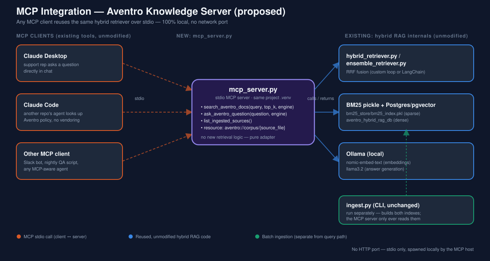

# Architecture: Aventro Knowledge MCP Server

**Status:** proposed design (not yet implemented). This document specifies
how an `mcp_server.py` would be added to `hybrid_rag_bm25_vector` to expose
the existing hybrid retriever over MCP. See `USE_CASE.md` for *why*; this
document covers *how*.



---

## 1. Design goal

Add exactly one new file, `mcp_server.py`, at the project root, that:

1. **Imports, not reimplements** — reuses `hybrid_retriever.py`,
   `ensemble_retriever.py`, `bm25_index.py`, `vector_store.py`,
   `embedder.py`, and `ask.py`'s `generate_answer()` as a library. Zero
   duplicated retrieval/generation logic.
2. **Runs over stdio**, spawned as a local subprocess by the MCP host
   (Claude Desktop, Claude Code, or any other MCP client) — no HTTP port,
   no network listener, no auth to configure.
3. **Changes nothing about ingestion.** `python ingest.py` keeps building
   the two indexes (pgvector table, BM25 pickle) exactly as today; the MCP
   server only ever *reads* them, same as `ask.py` does now.

---

## 2. Where it sits in the existing architecture

The root `README.md`'s pipeline diagram (`../architecture.svg`) ends at
"E. Ollama LLM → F. Answer", driven by `ask.py` on the command line. This
proposal adds a **parallel query-time entry point** that drives the exact
same internals, so there are now two ways in:

```
                 ┌───────────────────────────────────────────┐
                 │   EXISTING: ask.py (CLI, unchanged)        │
                 │   python ask.py "question"                 │
                 └───────────────────┬───────────────────────┘
                                      │
                                      ▼
   ┌────────────────────────────────────────────────────────────┐
   │   hybrid_retriever.py  /  ensemble_retriever.py  (unchanged) │
   │   -> BM25 pickle (bm25_store/)  +  Postgres/pgvector          │
   │   -> embedder.py (Ollama nomic-embed-text)                    │
   │   -> ask.generate_answer() (Ollama llama3.2)                  │
   └────────────────────────────────────────────────────────────┘
                                      ▲
                                      │
                 ┌───────────────────┴───────────────────────┐
                 │   NEW: mcp_server.py (this proposal)        │
                 │   stdio MCP server, same project venv       │
                 └───────────────────▲───────────────────────┘
                                      │ stdio (spawned subprocess)
                 ┌───────────────────┴───────────────────────┐
                 │   MCP HOST (Claude Desktop / Claude Code /  │
                 │   any MCP-aware client)                     │
                 └──────────────────────────────────────────┘
```

`ingest.py` is untouched and sits entirely outside this diagram — it's a
one-time/periodic batch job run directly, not something either `ask.py` or
`mcp_server.py` trigger.

---

## 3. Transport & process model

- **Transport:** stdio (`mcp.server.stdio`), the standard local transport
  for single-user, same-machine MCP servers — matches the "100% local"
  constraint already documented for the rest of this project (see root
  `README.md` → "Why Postgres + pgvector instead of a managed vector DB").
- **Process lifecycle:** the MCP host launches `mcp_server.py` as a child
  process when the user's session starts (per its own MCP server config,
  see §6) and tears it down when the session ends. The server is stateless
  across calls other than holding open its Postgres connection pool and
  the in-memory BM25 model — both already how `ask.py` behaves per-run
  today, just kept alive across *multiple* tool calls instead of exiting
  after one.
- **No new credentials.** The server reads the same `.env` / `config.py`
  this project already uses (`POSTGRES_*`, `EMBEDDING_MODEL`, `LLM_MODEL`,
  `BM25_INDEX_PATH`, ...). No new secrets are introduced.

---

## 4. Tool & resource schemas

### 4.1 `search_aventro_docs` (tool, retrieval only)

Thin wrapper around `hybrid_retriever.hybrid_search()` /
`ensemble_retriever.ensemble_search()` — no LLM call, fast, cheap.

```jsonc
{
  "name": "search_aventro_docs",
  "description": "Hybrid (BM25 + vector) search over the Aventro Motors PDF corpus. Returns the fused top-k chunks with source file, chunk index, and fusion score -- no answer generation.",
  "inputSchema": {
    "type": "object",
    "properties": {
      "query":  { "type": "string", "description": "Natural-language or keyword query." },
      "top_k":  { "type": "integer", "default": 4, "description": "Number of fused chunks to return." },
      "engine": { "type": "string", "enum": ["custom", "ensemble"], "default": "custom",
                  "description": "custom = hand-rolled RRF (hybrid_retriever.py); ensemble = LangChain EnsembleRetriever (ensemble_retriever.py), auto-falls back to custom if unavailable." }
    },
    "required": ["query"]
  }
}
```

Maps directly onto the existing function signature:
`hybrid_search(query, bm25_index, k_final=top_k, method=...)` — see
`hybrid_retriever.py`.

### 4.2 `ask_aventro_question` (tool, full RAG)

```jsonc
{
  "name": "ask_aventro_question",
  "description": "Answers a question about Aventro Motors vehicles/services using ONLY the ingested PDF corpus, via hybrid retrieval + a local Ollama LLM. Returns the answer plus the source chunks it was grounded in.",
  "inputSchema": {
    "type": "object",
    "properties": {
      "question": { "type": "string" },
      "engine":   { "type": "string", "enum": ["custom", "ensemble"], "default": "custom" }
    },
    "required": ["question"]
  }
}
```

Internally: `retrieve()` (from `ask.py`) → `generate_answer(query, results)`
(also from `ask.py`, unchanged) → returns `{"answer": str, "sources": [...]}`.

### 4.3 `list_ingested_sources` (tool)

```jsonc
{
  "name": "list_ingested_sources",
  "description": "Lists the PDF files currently indexed in both the dense (pgvector) and sparse (BM25) stores, with chunk counts -- for verifying what the knowledge base currently covers.",
  "inputSchema": { "type": "object", "properties": {} }
}
```

Backed by a new tiny query (`SELECT source_file, COUNT(*) FROM
hybrid_document_chunks GROUP BY source_file`) alongside the existing
`vector_store.count_chunks()`.

### 4.4 `aventro://corpus/{source_file}` (resource, optional)

A read-only MCP *resource* (not a tool — resources are for a client to
fetch/browse, not "call") exposing the full concatenated chunk text for one
source PDF, keyed by the same `source_file` value already stored in every
chunk's metadata. Useful when an agent wants the whole procedure, not one
~800-char chunk.

---

## 5. Request/response flow — example

```
User (in Claude Desktop): "How do I change a tyre on an Aventro Swift Sedan?"

1. MCP host recognizes the `aventro-rag` server's `ask_aventro_question` tool
   as relevant, calls it with {"question": "How do I change a tyre..."}.

2. mcp_server.py:
     results = ask.retrieve(question)              # hybrid_retriever.hybrid_search()
     answer  = ask.generate_answer(question, results)  # Ollama llama3.2, local
     return {
       "answer": answer,
       "sources": [
         {"source_file": "...How to Change a Tyre.pdf", "chunk_index": 0, "score": 0.0328},
         ...
       ]
     }

3. MCP host renders `answer` in the chat, optionally surfacing `sources`
   as citations/footnotes.
```

This is *exactly* the retrieval + generation path already proven working
end-to-end in the root `README.md`'s worked example — the MCP server adds
no new logic, only a new way to invoke it.

---

## 6. Deployment (MCP host configuration)

Claude Code's `.mcp.json` (or Claude Desktop's `claude_desktop_config.json`)
entry would look like:

```json
{
  "mcpServers": {
    "aventro-rag": {
      "command": "/Users/srinivaskotipalli/mai-practitioner/RAG/hybrid_rag_bm25_vector/.venv/bin/python",
      "args": ["mcp_server.py"],
      "cwd": "/Users/srinivaskotipalli/mai-practitioner/RAG/hybrid_rag_bm25_vector"
    }
  }
}
```

Using the project's own `.venv` interpreter means no dependency drift from
whatever environment the MCP host itself runs in — the server gets exactly
the `langchain-*`, `psycopg`, `pgvector`, `rank-bm25` versions already
pinned in `requirements.txt`.

**Prerequisites are identical to running `ask.py` today:** Ollama serving
`nomic-embed-text` + `llama3.2`, Postgres with the ingested
`aventro_hybrid_rag_db`, and `bm25_store/bm25_index.pkl` present (i.e.
`python ingest.py` has been run at least once). `test_setup.py`'s existing
preflight checks apply unchanged.

---

## 7. Security & trust boundary

- **stdio only, no network listener** — the server is only reachable by
  whatever process spawned it (the MCP host), on the same machine. There is
  no port to firewall or secure.
- **Read-mostly** — all four primitives in §4 only *read* the two indexes;
  nothing in this design lets an MCP client trigger re-ingestion, write to
  Postgres, or execute arbitrary SQL. (A `reindex` tool, if added later per
  §8, should require explicit confirmation in the host, the same way this
  session asks before destructive actions.)
- **No new secrets** — reuses the existing `.env` (Postgres creds that are
  `trust`-auth-local-only per the root README's note). No API keys exist
  anywhere in this stack to begin with.
- **Answer grounding is unchanged** — `generate_answer()`'s prompt already
  instructs the LLM to answer *only* from retrieved context and say "I
  don't know" otherwise; the MCP server doesn't alter that contract, so
  hallucination risk is the same as the CLI path, not worse.

---

## 8. Future extensions (explicitly out of scope for this proposal)

- **`reindex_aventro_corpus` tool** — trigger `ingest.py` programmatically
  from an MCP client, with a confirmation step (re-ingestion is a write,
  unlike everything else here).
- **Per-vehicle-model filtering** — add a `source_file` or model-name filter
  parameter to `search_aventro_docs`, backed by the `WHERE
  metadata->>'source_file' = ...` pattern already suggested as an extension
  in the root `README.md`.
- **Streaming answers** — MCP supports progress/streaming notifications;
  `ask_aventro_question` could stream `generate_answer()`'s tokens instead
  of returning one blocking response, for long answers.
- **Multi-corpus support** — generalize beyond the Aventro corpus to any
  `CORPUS_DIR`, turning this into a reusable "hybrid RAG MCP server"
  template rather than an Aventro-specific one.
